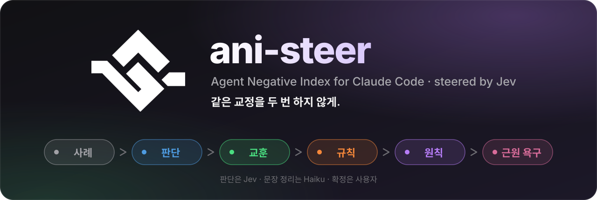
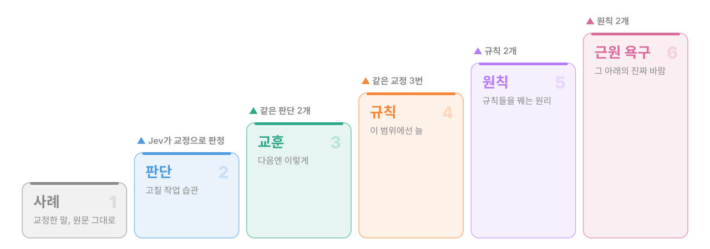
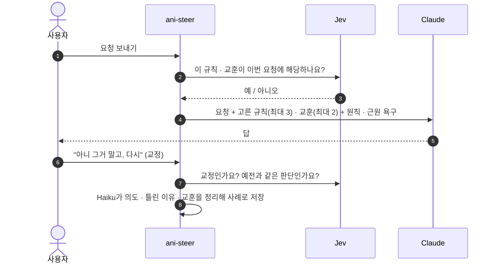

<p align="center">
  
</p>

<p align="center">
  <a href="https://docs.claude.com/en/docs/claude-code"></a>
  
  
  <a href="https://typesafe.ai"></a>
  <a href="LICENSE"></a>
</p>

<p align="center">
  <b>Claude에게 한 교정을 사례로 쌓고, 사다리로 올려, 다음 요청에 해당되는 것만 골라 붙입니다.</b>
</p>

<p align="center">
  <a href="#-설치">설치</a> ·
  <a href="#-교정-사다리">교정 사다리</a> ·
  <a href="#%EF%B8%8F-작동-방식">작동 방식</a> ·
  <a href="#-기능">기능</a> ·
  <a href="#%EF%B8%8F-화면">화면</a> ·
  <a href="#-개인정보">개인정보</a> ·
  <a href="PRD.md">설계 문서</a>
</p>

---

## 💡 왜 필요한가

> "폰트 키워"를 세 번째 말하고 있다면.

Claude는 세션이 끝나면 교정을 잊습니다. 그렇다고 메모에 규칙으로 적어 두면, 이번엔 반대 방향으로 지나칩니다. 피드백은 대부분 **그때 그 결과물에 대한 말**이기 때문입니다.

ani-steer는 교정을 곧바로 규칙으로 굳히지 않습니다. **사례로 쌓고**, 같은 판단이 되풀이될 때만 한 단계씩 올리고, 요청마다 **지금 해당되는 것만** 골라 붙입니다. 목표는 두 가지입니다.

- 🔁 **같은 말을 두 번 하게 만들지 않기**
- ↔️ **반대 피드백을 부르지 않기**

## 🪜 교정 사다리

<p align="center">
  
</p>

| 단계 | 무엇인가 | 올라가는 조건 |
|---|---|---|
| 💬 **사례** | 사용자가 Claude를 교정한 말, 원문 그대로 | Jev가 교정이라고 판정하면 기록 |
| 🧭 **판단** | 사례에서 읽은, 고칠 작업 습관 (예: `지정된 범위를 넓혀서 해석함`) | Haiku가 한 단계 일반화해 적음 |
| 📝 **교훈** | 다음에 같은 상황이면 어떻게 할지 | 같은 판단 2개 → `교훈으로` |
| 📏 **규칙** | 그 범위에서 늘 지킬 것 | 같은 교정 3번 → `규칙으로` |
| 🧱 **원칙** | 여러 규칙을 꿰는 원리 | 규칙 2개 → `원칙으로 확정` |
| ❤️ **근원 욕구** | 원칙들 아래에 있는 진짜 바람 | 원칙 2개 → `이걸로 확정` |

> [!IMPORTANT]
> **자동으로 확정되는 것은 없습니다.** 후보는 패널에 카드로 올라오고, 올릴지(`교훈으로`, `규칙으로` …) 그대로 둘지(`아님`, `아직 교훈으로` …)는 언제나 사용자가 고릅니다.

## ⚙️ 작동 방식



**무엇이 붙나**

| 대상 | 판정 방식 | 붙는 개수 |
|---|---|---|
| 📏 규칙 | 범위 안의 것을 모두(최대 16개) Jev가 판정 | 최대 3개 |
| 📝 교훈 | 요청과 낱말이 겹치는 것을 Jev가 판정 | 최대 2개 |
| 🧱 원칙 · ❤️ 확정된 근원 욕구 | 판정 없이 | 매번 |

**누가 무엇을 하나**

| 일 | 담당 |
|---|---|
| 예 / 아니오 판정: 교정인가, 해당되나, 같은 판단인가, 어느 범위인가 | **Jev** (TypeSafe System One) |
| 문장 정리: 의도, 틀린 이유, 교훈, 한 줄 요약 | **Haiku** (Claude Code 안에서) |
| 승격 확정, 범위 바꾸기, 잊기 | **사용자** |

## ✨ 기능

<table>
<tr>
<td width="50%" valign="top">

### 🎯 요청마다 골라 붙이기
모든 교훈을 매번 밀어 넣지 않습니다. Jev가 이번 요청에 해당되는 것만 고르고, 이미 대화에 있는 교훈은 다시 붙이지 않습니다.

</td>
<td width="50%" valign="top">

### 🗂️ 프로젝트마다 다른 범위
교훈·규칙·지시는 말한 프로젝트에서만 붙고, 응답 언어나 커밋 습관처럼 어디서나 통하는 것은 모든 프로젝트에 붙습니다.

</td>
</tr>
<tr>
<td valign="top">

### 🔍 지난 대화에서 사례 찾기
설치하기 전의 교정도 사례가 됩니다. 지난 45일 Claude Code 대화에서 사용자가 직접 보낸 요청만 읽어 교정을 찾아냅니다.

</td>
<td valign="top">

### 🧳 예전 기록 가져오기
옛 ani 플러그인 기록(`~/.ani/patterns`)과 Claude 자동 메모리의 `feedback` 노트를 한국어 교훈으로 가져옵니다. 원본은 건드리지 않습니다.

</td>
</tr>
<tr>
<td valign="top">

### 🔗 같은 판단 묶기
말과 프로젝트가 달라도 같은 습관이면 하나로 묶습니다. 두 프로젝트에서 같은 실수가 나오면 모든 프로젝트의 교훈 후보가 됩니다.

</td>
<td valign="top">

### 🧹 사용자의 말만 기록
앱 알림, 예약 작업, 다른 에이전트가 보낸 지시, 붙여 넣은 터미널 조각은 사례가 되지 않습니다.

</td>
</tr>
</table>

<details>
<summary><b>🗂️ 범위는 어떻게 정해지나</b></summary>
<br>

- 이 프로젝트 것인지 모든 프로젝트 것인지는 **저장할 때 Jev가 판정**합니다. `한 번에 관리`에서 `이 프로젝트` / `모든 프로젝트`로 바꿀 수 있습니다.
- 다른 프로젝트의 것은 `다른 프로젝트의 ○○ · 참고`에 프로젝트 이름과 함께 접혀 있고, 묻지 않습니다. `한 번에 관리`의 `모든 프로젝트로`를 누르면 어디서나 붙습니다.
- 프로젝트는 `owner/repo`, 폴더 이름, Windows 경로 중 무엇으로 기록됐든 **마지막 이름이 같으면 같은 프로젝트**로 봅니다.
- 프로젝트 기록이 생기기 전에 저장된 지시는 대화 기록에서 저장된 시각의 요청을 찾아 그 세션의 프로젝트를 채웁니다(예약 작업이 보낸 요청 포함). 못 찾으면 `출처 모름`으로 남고 다시 찾지 않습니다.

</details>

<details>
<summary><b>🔍 지난 대화에서 사례 찾기, 자세히</b></summary>
<br>

- `사례` 탭의 **`지난 45일 대화에서 사례 찾기`** 를 누르면 Claude Code 대화 기록(`~/.claude/projects/*.jsonl`)에서 사용자가 직접 보낸 요청만 읽고, Jev가 10개씩 묶어 교정인지 판정합니다.
- 요청마다 **앞뒤 대화**(이전 요청 3개, 에이전트의 답과 실제로 한 작업, 다음 요청 2개)를 함께 보여 주므로, 질문으로 한 교정(`X 아니지???`)이나 다음 지시와 섞인 교정도 찾습니다.
- 교정이면 사례가 되고, 실시간 교정과 같은 사다리를 탑니다.
- 읽은 기록은 세션 단위로 표시해 두어서, 중간에 멈추면 다시 눌러 이어서 할 수 있습니다.
- 예전 기준으로 찾은 경우 `새 기준으로 다시 찾기`가, 45일을 다 읽은 뒤에는 그 이전 대화를 찾는 버튼이 나옵니다.

</details>

<details>
<summary><b>🧳 예전 기록은 이렇게 가져옵니다</b></summary>
<br>

**옛 ani 플러그인 (`~/.ani/patterns`)**: 처음 한 번 가져옵니다.

| 옛 기록 | 여기서는 |
|---|---|
| S | 모든 프로젝트의 교훈 |
| 정리되지 않은 F | 그 F를 말한 프로젝트의 교훈 |
| S로 묶인 F | 그 S의 사례 |

- 옛 기록은 영어 요약이 사용자의 말 자리에 있었습니다. 세션이 시작될 때 몇 개씩 한국어로 다시 쓰고, 사용자가 실제로 한 말(기록의 `> user:` 발췌, S는 그 S를 만든 F의 발췌)로 바꿉니다.
- 여기서 잊은 항목은 다시 가져오지 않습니다.

**Claude 자동 메모리 (`~/.claude/projects/*/memory/*.md`)**: `feedback` 노트를 세션 시작마다 12개까지 한국어 교훈으로 가져옵니다. 노트를 쓴 폴더의 프로젝트에 붙고, 홈 폴더에서 쓴 노트는 모든 프로젝트에 붙습니다.

원본 파일은 어느 쪽도 건드리지 않습니다.

</details>

<details>
<summary><b>🔗 같은 판단은 어떻게 묶이나</b></summary>
<br>

1. 사례마다 Haiku가 고칠 작업 습관을 한 단계 일반화해 적습니다. 예: `지정된 범위를 넓혀서 해석함`
2. Jev가 새 습관이 예전 것과 같은지 판정합니다. 말과 프로젝트가 달라도 같으면 묶입니다.
3. 두 프로젝트에서 같은 실수가 나오면 **모든 프로젝트의 교훈 후보**가 됩니다.
4. 교훈 후보는 `교훈` 탭에서 `교훈으로` / `아님`으로, 같은 교정이 3번 쌓인 교훈은 `규칙` 탭에서 `규칙으로` / `아직 교훈으로`로 확정합니다.

</details>

<details>
<summary><b>🧹 사례가 되지 않는 것</b></summary>
<br>

사용자가 직접 친 말만 사용자의 말로 기록합니다. 다음은 사례·지시가 되지 않습니다.

- 앱 알림: `<system-reminder>`, `<ci-monitor-event>`, `<task-notification>`
- 예약 작업, 다른 에이전트·세션이 보낸 지시 (대화 기록의 `origin`이 `human`이 아닌 것)
- 다른 프로그램이 시작한 세션 (`claude -p`, SDK)
- 앱 도우미의 역할 지시 (`You are a ...`)

붙여 넣은 터미널 조각은 떼어 냅니다. 이미 그렇게 저장된 지시는 대화 기록에서 출처를 찾아 따로 빼 둡니다.

</details>

## 🖥️ 화면

| 어디에 | 무엇이 |
|---|---|
| **프롬프트 위 한 줄** | 지금 붙일 교훈·규칙과 개수. 누르면 패널이 열립니다 |
| **패널** (`/ani`) | `사례` · `교훈` · `규칙` · `원칙` · `근원 욕구` │ `보낸 내용` · `설정` |
| **승격 카드** | 교훈·규칙·원칙·근원 욕구 후보를 `확정` / `아직` 으로 고르는 카드 |
| **토스트** | 사례를 기록했을 때, 교훈을 붙여 보냈을 때 잠깐 뜨는 한 줄 |

`설정` 탭에서 프롬프트 위·아래 상태 줄, 토스트, 패널 자동 열기를 각각 켜고 끌 수 있습니다. 레이아웃은 움직이지 않습니다. 내용이 없어도 한 줄을 유지합니다.

## 📦 설치

**1. 마켓플레이스를 추가하고 플러그인을 설치합니다.**

```text
/plugin marketplace add ThingsLikeClaude/ani-steer-public
/plugin install jev-steer@ani-steer
```

**2. Jev(TypeSafe) 키를 넣습니다.** [typesafe.ai](https://typesafe.ai)에서 발급받으세요.

키가 없으면 첫 실행 때 프롬프트 위에 안내 카드가 뜹니다. **`키 설정하기`** 를 누르거나 `/jev-steer:ani-key`를 실행하면 가려진 입력창이 열리고, 붙여 넣은 키는 `~/.claude/settings.json`의 `env.TYPESAFE_API_KEY`에 저장됩니다.

**3. `/reload-plugins` 하거나 새 세션을 엽니다.** 패널의 Jev 연결 점이 초록색이면 준비 끝입니다.

> [!TIP]
> 키는 채팅에 남지 않습니다. macOS · Linux · Windows 모두 지원하며, jq 같은 외부 도구는 필요 없습니다.

<details>
<summary><b>🔑 키 스크립트 직접 실행하기</b></summary>
<br>

플러그인 폴더(이 저장소의 `plugins/jev-steer/`)에서 실행합니다.

| 작업 | macOS / Linux | Windows |
|---|---|---|
| 설정 · 변경 | `bash bin/ani-key.sh` | `powershell -NoProfile -ExecutionPolicy Bypass -File bin\ani-key.ps1` |
| 상태 확인 | `bash bin/ani-key.sh --status` | `… ani-key.ps1 -Status` |
| 삭제 | `bash bin/ani-key.sh --remove` | `… ani-key.ps1 -Remove` |

- 입력창: macOS는 시스템 입력창, Windows는 가려진 입력창(Windows Forms), Linux는 zenity가 있으면 입력창, 없으면 터미널 숨김 입력.
- macOS / Linux는 node · python3 · osascript 중 있는 것으로 JSON을 고칩니다.

</details>

## 🔒 개인정보

| 구분 | 내용 |
|---|---|
| **Jev로 보내는 것** | 방금 보낸 요청, 직전 요청 몇 개, Claude의 마지막 답 끝부분, 프로젝트 이름, 판정할 교훈·규칙 문장 |
| **지난 대화 찾기 때 더 보내는 것** | 과거 요청과 앞뒤 대화 일부, 에이전트가 쓴 도구 이름과 파일 이름·명령 앞부분 |
| **보내지 않는 것** | 파일 내용, 도구 결과 |
| **문장 정리** | Claude Code 안의 Haiku |
| **키** | `~/.claude/settings.json`의 `env.TYPESAFE_API_KEY` |

## 💾 저장

모든 기록은 Claude Code 플러그인 저장소 `$.store`에 JSON으로 저장됩니다.

| 키 | 내용 |
|---|---|
| `feedbackLog` | 💬 사례 |
| `cards` | 📝 교훈 · 📏 규칙 |
| `requirements` | 지시 |
| `principles` | 🧱 원칙 |
| `needs` | ❤️ 근원 욕구 |

## 🗺️ 저장소 구조

```text
ani-steer-public/
├── .claude-plugin/marketplace.json     마켓플레이스 (ani-steer)
├── plugins/jev-steer/
│   ├── .claude-plugin/plugin.json      플러그인 (jev-steer)
│   ├── hooks/
│   │   ├── register.tsx                엔진: 판정 · 기록 · 승격 · 패널
│   │   ├── core.ts                     후보 고르기, 범위, 프로젝트 판별
│   │   ├── history.ts                  지난 대화 읽기
│   │   ├── ui.ts                       상태 줄 · 패널 그림(SVG)
│   │   └── *.test.ts(x)                테스트
│   ├── skills/ani-key/SKILL.md         키 설정 스킬
│   ├── bin/ani-key.sh · ani-key.ps1    가려진 입력창으로 키 저장
│   └── types/index.d.ts                데이터 타입
├── PRD.md                              설계 문서
└── LICENSE                             MIT
```

## 🙏 바탕

- [**ani**](https://github.com/ThingsLikeClaude/ani): Agent Negative Index. 교정을 F → S로 쌓는 원래 규약
- [**Jev**](https://typesafe.ai): TypeSafe System One. 닫힌 질문에 빠르게 답하는 판정 모델
- [**Claude Code**](https://docs.claude.com/en/docs/claude-code): 모드와 플러그인

## 📄 라이선스

[MIT](LICENSE) © ThingsLikeClaude

<br>

<p align="center">
  <sub>교정은 한 번이면 충분합니다.</sub>
</p>
